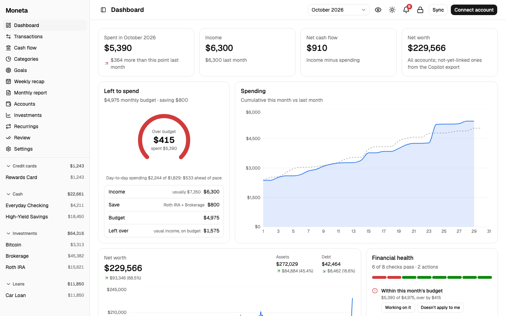
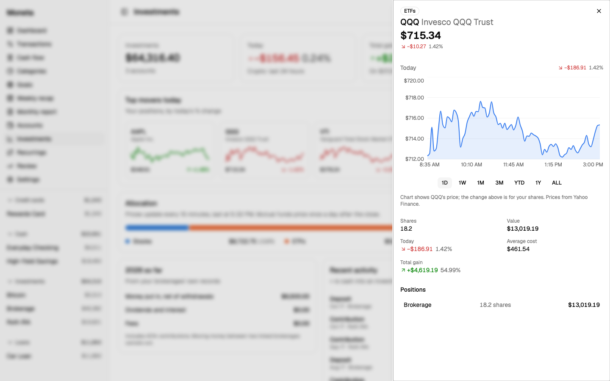
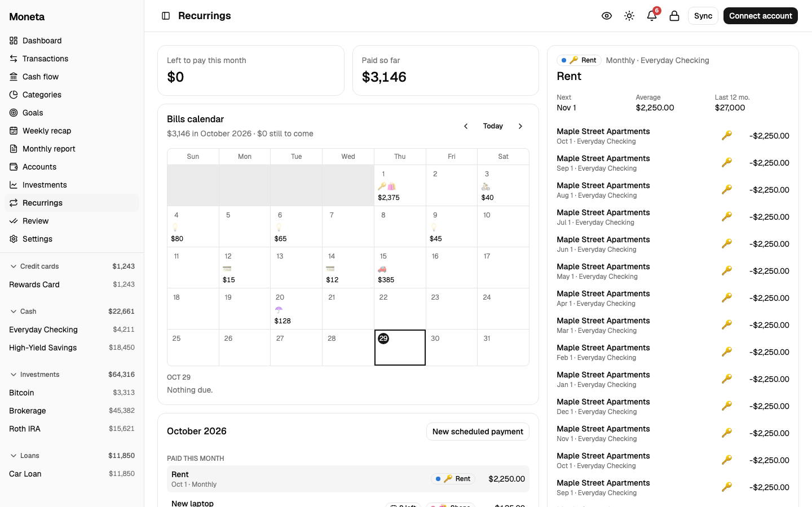
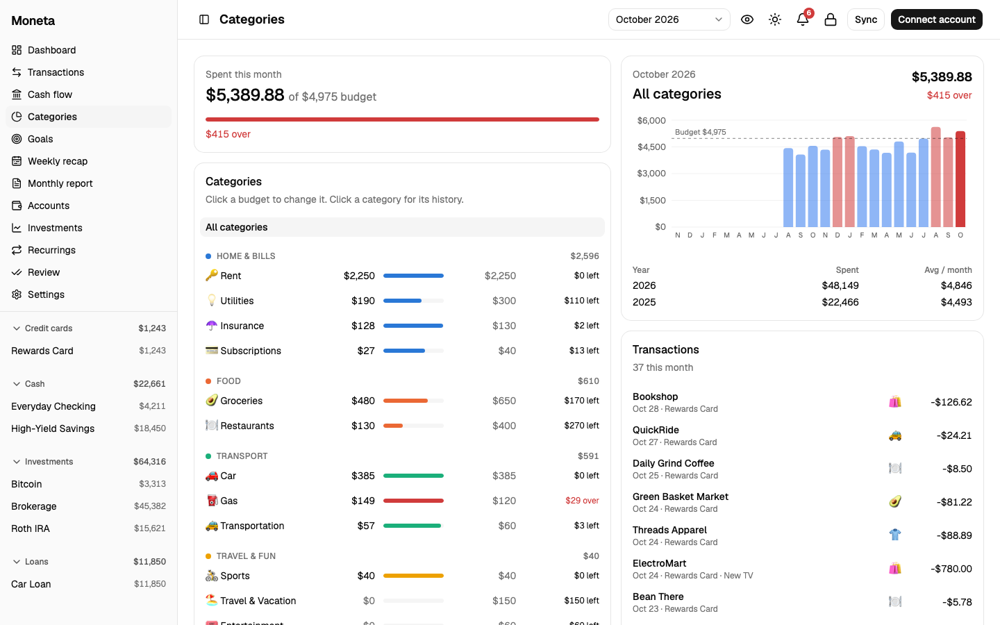
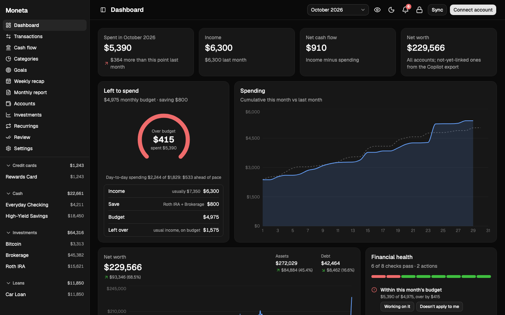

# Moneta

*Moneta* is Latin for coin, and where the word "money" comes from.

A personal finance app that runs on your own laptop. Your bank data goes from Plaid to a SQLite file on your disk and
nowhere else: no account, no cloud, no tracking. Think Copilot Money or Monarch, but local and yours to change.



## What it does

- **Every account in one place.** Banks, cards, brokerages and loans through [Plaid](https://plaid.com), plus manual
  accounts for anything Plaid can't reach (a store card, an HSA, cash, Bitcoin or gold priced live).
- **Spending you can trust.** Categories, overlapping tags (a person, a trip, a side project), rules that apply to past
  and future transactions, splits, and payment plans: a purchase spread over months, or a store-card plan you pay by
  hand with a reminder each month. PayPal purchases are paired with the card that paid them, so nothing counts twice,
  and foreign-currency payments are converted at that day's rate.
- **Budgets and goals.** A "left to spend" ring with pacing that ignores rent landing on the 1st, a budget scorecard
  per category, monthly saving goals, and a cash cushion to rebuild.
- **Investments, live.** Positions from every brokerage with live prices (stocks, ETFs, funds, crypto), today's top
  movers, and a side panel per position with its price chart from one day to all time.
- **Reviews that tell you something.** A weekly recap, a monthly report, financial health checks with actions, and
  alerts for overspending, unusual charges, price changes, missed bills and card due dates.
- **Private by default.** Optional passkey lock (Touch ID, Windows Hello, your phone or a security key), a blur whenever the window loses focus, an eye button that hides
  every amount, light and dark themes.

| | |
|---|---|
|  |  |
|  |  |

## Get started

Requires [Node.js](https://nodejs.org) 24 or newer (it uses the built-in `node:sqlite`).

```bash
git clone <this repo's URL> moneta && cd moneta   # the green Code button on GitHub has it
npm start                                          # then open http://localhost:3000
```

That's it: the first run installs and builds the web UI by itself (about a minute), later runs start right away, and
after a `git pull` it rebuilds what changed. Without Plaid keys Moneta works with accounts you add by hand; add keys
(below) to connect banks.

**Just want to look around?** `npm run demo` opens it with 14 months of a made-up person's money instead, on its own
database (`ledger-demo.db`; delete it to start the demo over).

## Use it with your own accounts

1. **Get Plaid keys.** Sign up at [dashboard.plaid.com](https://dashboard.plaid.com). Sandbox keys are free and work
   with Plaid's test banks. Real banks need Plaid's production access: their free Trial plan allows 10 connections
   ("Items") **for good**, and removing one doesn't give the slot back, so link each bank once.
2. **Configure.** `cp .env.example .env` and fill in `PLAID_CLIENT_ID`, `PLAID_SECRET` and `PLAID_ENV` (`sandbox` or
   `production`). Each environment gets its own database file, so test data never mixes with real data.
3. **Run.** `npm start` (restart it after changing `.env`), open http://localhost:3000 (use `localhost`, not
   `127.0.0.1`), and click **Connect account**.
   With sandbox keys, pick any test bank and sign in with `user_good` / `pass_good`.
4. **Make it yours.** Set budgets on the Categories page, goals on Goals, and rules from any transaction or on the
   Review page. Settings holds your categories, tags and where idle cash should go. Create a passkey when it asks.

Plaid checks each bank a few times a day; **Sync** pulls whatever it has. Accounts show when Plaid last reached the bank.

### Coming from Copilot Money

Export your transactions from Copilot as CSV, save the file as `copilot-export/copilot-transactions.csv`, and run
`sqlite3 ledger-production.db < import-copilot.sql` (needs the `sqlite3` command line tool). Your categories, tags, notes and recurring names come along.
Each linked account takes over from its first day in Plaid; before that, the Copilot history is used, and the overlap
is matched one to one so nothing is counted twice. (`npm run check` prints the match report.)

## Security

- The server listens on `127.0.0.1` only and checks the `Host` header, so other machines and other websites can't reach
  it. Every write needs `Content-Type: application/json`.
- With a passkey set up, every API call needs a session from it (WebAuthn, with fingerprint, face or PIN); the page locks after 5 idle minutes,
  when the computer sleeps, and after a minute in the background. Without a passkey, anything running on your computer can
  read the API, so turn it on if others use the machine.
- Plaid access tokens live in the SQLite file next to your data. Keep disk encryption (FileVault) on. The server makes
  the database readable by your user only; do the same for your keys with `chmod 600 .env`.

## Development

To work on the code, `npm run dev` (or `npm run dev:demo` with sample data) starts the server and the page together:
open http://localhost:5173. The page reloads as you edit `web/`, and the server restarts when its files change.

```bash
npm start                   # API + built UI on :3000 (reads .env)
npm run dev                 # server + Vite dev server on :5173 with live reload (dev:demo for sample data)
node ledger.js              # self-check of the merge, rules, recurrings, alerts and health logic
node auth.js                # self-check of the passkey (WebAuthn) verification
```

- `server.js` is a dependency-free Node HTTP server: Plaid calls, SQLite schema and migrations, every `/api/*` route.
- `ledger.js` is the pure logic (merging sources, rules, recurrings, alerts, health checks), with its tests at the bottom.
- `web/` is the UI: Vite, React, TypeScript, Tailwind and shadcn/ui.
- `CLAUDE.md` describes how everything fits together, for people and for coding agents.

## Contributing

Issues and pull requests are welcome: bug reports, ideas, a bank that behaves oddly through Plaid, or a fix.

- **Never post real financial data** in an issue or pull request: no transactions, balances, account numbers, screenshots
  of your own accounts, or anything from your `.env`. Reproduce problems with `npm run demo`, or replace the numbers and
  names with made-up ones.
- Keep the server free of dependencies (UI packages go in `web/`), and run `node ledger.js` and `node auth.js` before
  sending a change. `CLAUDE.md` explains how the pieces fit together.
- This is a side project shared as-is: replies and reviews may take a while.

## License

[MIT](LICENSE). This is not financial advice, and it comes with no warranty: check the numbers that matter.
